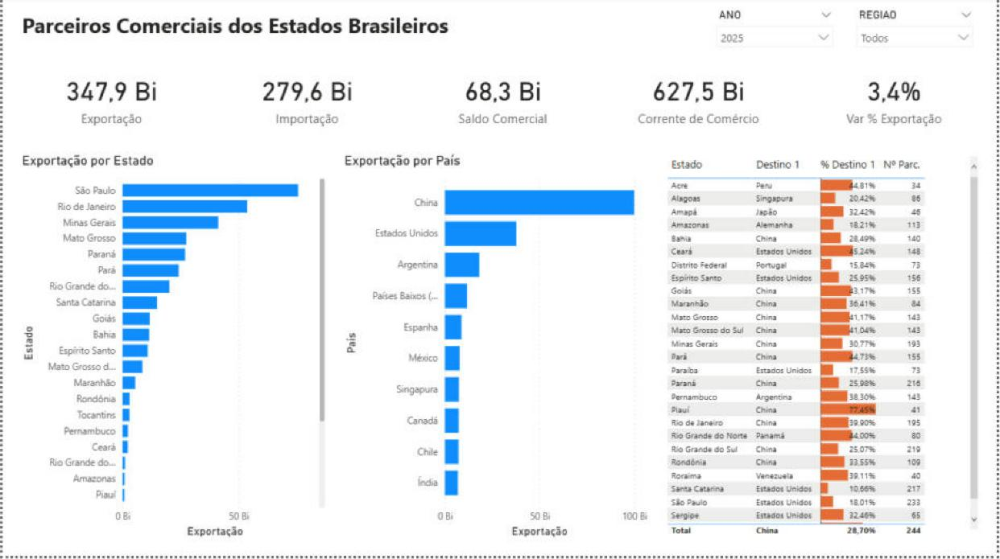
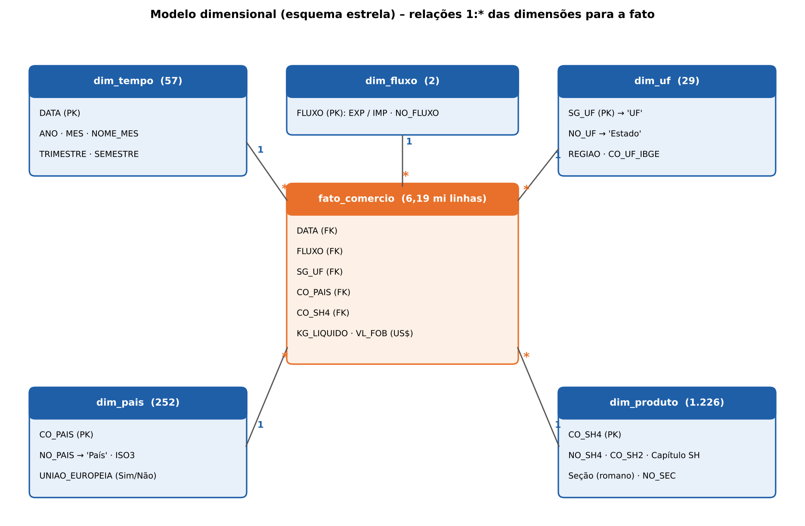

# Parceiros comerciais dos estados brasileiros (2022–2026)

Solução de Business Intelligence e Analytics com dados públicos do **Comex Stat (MDIC)**.
Trabalho de Conclusão de Curso (Projeto Integrado) – Pós-graduação Lato Sensu em Analytics e Business Intelligence, PUC Minas.

**Autor:** Robson Douglas de Almeida

## Pergunta de negócio

Quem são os principais parceiros comerciais de cada estado brasileiro, quanto pesam no comércio do estado e como essa relação evolui? O projeto cobre exportações e importações por UF, país e produto (SH4) de janeiro de 2022 a setembro de 2026.

## Conteúdo do repositório

| Pasta / arquivo | Conteúdo |
|---|---|
| `etl_comex.py` | ETL (Módulo A): lê os arquivos brutos por município, agrega por UF, monta o modelo estrela e valida os totais contra a fonte |
| `modulo_c.py` | Análises avançadas (Módulo C): previsão das exportações/importações e agrupamento (K-Means) das UFs por perfil de parceiros e produtos |
| `dados/` | Dimensões do modelo estrela e a tabela de validação dos totais (homologação do ETL) |
| `resultados/` | Saídas do Módulo C: séries previstas, métricas (MAPE), grupos de UFs, gráficos e as tabelas carregadas no Power BI (`pbi_*.csv`) |
| `imagens/` | Diagramas do modelo e do ETL e capturas dos painéis do Power BI |
| `relatorio/` | Relatório técnico final do projeto (PDF entregue e versão Word) |
| `dashboard/` | Arquivo do dashboard `Parceiros_Comerciais_Estados_Brasileiros.pbix` (Power BI Desktop) |
| `videos/` | Vídeos de apresentação: dashboard (Módulo B) e análises avançadas (Módulo C) |

## Dashboard (Power BI)

Quatro páginas: **Estratégico** (visão Brasil e ranking de parceiros), **Tático** (UF × país), **Operacional** (UF, país e produto, com preço médio US$/kg) e **Análises Avançadas** (previsão e grupos de UFs).

## Modelo de dados

Modelo estrela com a fato `fato_comercio` (mês × fluxo × UF × país × SH4 → valor FOB US$ e kg líquido) e as dimensões `dim_tempo`, `dim_uf`, `dim_pais`, `dim_produto` e `dim_fluxo`.

## Como reproduzir

1. Baixe na [base de dados bruta do Comex Stat](https://www.gov.br/mdic/pt-br/assuntos/comercio-exterior/estatisticas/base-de-dados-bruta) os arquivos `EXP_aaaa_MUN.csv` e `IMP_aaaa_MUN.csv` de 2022 a 2026 e as tabelas auxiliares `NCM_SH.csv`, `PAIS.csv` e `UF_MUN.csv`.
2. Instale as dependências: `python -m pip install pandas numpy scikit-learn matplotlib`
3. Rode o ETL: `python etl_comex.py <pasta_dos_brutos> <pasta_saida>`
   A fato `fato_comercio.csv` (cerca de 6,2 milhões de linhas, 230 MB) não está no repositório por ultrapassar o limite de tamanho do GitHub; ela é gerada por este passo.
4. Rode as análises: `python modulo_c.py`
5. Abra `dashboard/Parceiros_Comerciais_Estados_Brasileiros.pbix` no Power BI Desktop e aponte as fontes para a pasta de saída.

## Principais resultados

- Totais do ETL conferem 100% com os arquivos brutos (ver `dados/validacao_totais.csv`).
- Previsão: a regressão com tendência e sazonalidade mensal teve o menor erro (MAPE de 7,5% nas exportações e 7,6% nas importações no teste de jan–set/2026).
- Agrupamento exploratório (K-Means, k = 3, silhueta 0,24): três perfis de estados – pauta e destinos diversificados (12 UFs), commodities concentradas na China (9 UFs) e voltados a EUA e União Europeia (6 UFs).
- Os valores do painel excluem as UFs EX/ND e os países 100 (Zona Franca) e 105 (Brasil); por isso ficam até 0,3% abaixo dos totais brutos de `dados/validacao_totais.csv`.

Fonte dos dados: Ministério do Desenvolvimento, Indústria, Comércio e Serviços (MDIC) – Comex Stat. Dados públicos.
